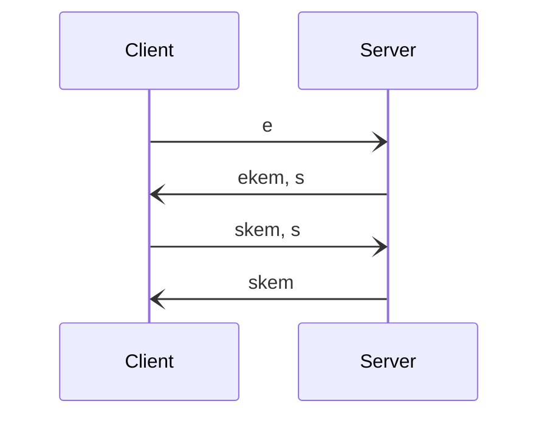

# Cryptography in Katzenpost

Back to the [README](../README.md).

Katzenpost is an unverified decryption mix network that uses a continuous time mixing strategy
with client selected exponential delays and a stratified routing topology.

## Cryptographic agility

Katzenpost consists of three core cryptographic protocols, all of which have cryptographic
agility with respect to the KEM, NIKE or signature scheme being used:

1. the wire protocol, based on PQ Noise;
2. Sphinx;
3. the PKI.

Each of these protocols uses our Go cryptography library,
[hpqc](https://github.com/katzenpost/hpqc) (hybrid post-quantum cryptography). Each protocol is
written against a small set of Go interfaces for KEM, NIKE and signature schemes, so it is
agnostic to the primitive behind them, and each lets its TOML configuration select the
primitive.

The tables below list the names that hpqc v0.0.95, the version `go.mod` pins, accepts. hpqc is
the authority: when it changes, `nike/schemes`, `kem/schemes` and `sign/schemes` in hpqc list
what is available.

### NIKE: non-interactive key exchange

| Primitive | hpqc name | Security |
| --- | --- | --- |
| X25519 | `x25519` | classical |
| X448 | `x448` | classical |
| CTIDH | `ctidh511`, `ctidh512`, `ctidh1024`, `ctidh2048` | post-quantum |
| CTIDH with X25519 | `CTIDH512-X25519`, `CTIDH1024-X25519` (alias `X25519-CTIDH1024`) | hybrid |
| CTIDH with X448 | `CTIDH512-X448`, `CTIDH1024-X448`, `CTIDH2048-X448` | hybrid |

### KEM: key encapsulation mechanism

| Primitive | hpqc name | Security |
| --- | --- | --- |
| ML-KEM | `MLKEM512`, `MLKEM768`, `MLKEM1024` | post-quantum |
| Hedged ML-KEM | `MLKEMHedged512`, `MLKEMHedged768`, `MLKEMHedged1024` | post-quantum |
| HQC | `HQC-128`, `HQC-192`, `HQC-256` | post-quantum |
| sntrup4591761, a version of NTRU | `sntrup4591761` | post-quantum |
| FrodoKEM-640-SHAKE | `FrodoKEM-640-SHAKE` | post-quantum |
| Classic McEliece | `mceliece348864`, `mceliece348864f`, `mceliece460896`, `mceliece460896f`, `mceliece6688128`, `mceliece6688128f`, `mceliece6960119`, `mceliece6960119f`, `mceliece8192128`, `mceliece8192128f` | post-quantum |
| X-Wing, which pre-combines ML-KEM-768 and X25519 | `XWING` | hybrid |
| ML-KEM with X25519, through our own combiner | `MLKEM512-X25519`, `MLKEM768-X25519`, `MLKEM1024-X25519`, and the `MLKEMHedged` forms of each | hybrid |
| Kyber768 with X25519 | `Kyber768-X25519` | hybrid |
| ML-KEM-1024 with X448 | `MLKEM1024-X448` | hybrid |
| HQC with X25519 or X448 | `HQC-128-X25519`, `HQC-192-X25519`, `HQC-256-X25519`, `HQC-256-X448` | hybrid |
| FrodoKEM-640-SHAKE with X448 | `FrodoKEM-640-SHAKE-X448` | hybrid |
| NTRU with X448 | `sntrup4591761-X448` | hybrid |
| Classic McEliece with X25519 | each McEliece name above with `-X25519` | hybrid |

Every NIKE above is also available as a KEM through the NIKE-to-KEM adapter, and any
combination of the above through the combiner. We implement our own combination of ML-KEM-768
and X25519, in addition to X-Wing, because of the security properties of the combiner in the
[KEM Combiners paper](https://eprint.iacr.org/2018/024).

### Signature schemes

| Primitive | hpqc name | Security |
| --- | --- | --- |
| Ed25519 | `Ed25519` | classical |
| Ed448 | `Ed448` | classical |
| ML-DSA | `ML-DSA-44`, `ML-DSA-65`, `ML-DSA-87` | post-quantum |
| Falcon | `Falcon-padded-512`, `Falcon-padded-1024` | post-quantum |
| SPHINCS+-SHAKE-256f | `Sphincs+` | post-quantum |
| ML-DSA with Ed25519 | `ML-DSA-44-Ed25519`, `ML-DSA-65-Ed25519`, `ML-DSA-87-Ed25519` | hybrid |
| Dilithium with Ed25519 or Ed448 | `Ed25519-Dilithium2`, `Ed448-Dilithium3` | hybrid |
| Falcon with Ed25519 | `Falcon-padded-512-Ed25519`, `Falcon-padded-1024-Ed25519` | hybrid |
| SPHINCS+ with Ed25519 or Ed448 | `Ed25519-Sphincs+`, `Ed448-Sphincs+` (legacy alias `Ed25519 Sphincs+`) | hybrid |

## Wire protocol: PQ Noise

All Katzenpost components talk to one another with our wire protocol, over TCP or QUIC. The
wire protocol pads its traffic, as a redundant measure against traffic analysis.

We prefer the [Noise Protocol Framework](https://noiseprotocol.org/) to TLS wherever possible.
Noise makes every protocol decision when the protocol is designed rather than when it runs, so
there are no downgrade attacks and no runtime ciphersuite negotiation. We use a variant called
[Post Quantum Noise](https://eprint.iacr.org/2022/539):

```
@misc{cryptoeprint:2022/539,
      author = {Yawning Angel and Benjamin Dowling and Andreas Hülsing and Peter Schwabe and Florian Weber},
      title = {Post Quantum Noise},
      howpublished = {Cryptology ePrint Archive, Paper 2022/539},
      year = {2022},
      doi = {10.1145/3548606.3560577},
      note = {\url{https://eprint.iacr.org/2022/539}},
      url = {https://eprint.iacr.org/2022/539}
}
```

The wire protocol accepts any KEM. With X-Wing, the Noise protocol name is
`Noise_pqXX_Xwing_ChaChaPoly_BLAKE2s`. This is the pqXX pattern:



## Sphinx

We use the Sphinx packet format, with a geometry that is fully configurable for different
network requirements. Sphinx can use any NIKE. We also developed a post-quantum variant, KEM
Sphinx. KEM Sphinx is twice as fast on the server side as NIKE Sphinx, because it needs one
public key operation per hop instead of two; its header grows linearly with the number of hops.

These benchmarks were run on one laptop, with no recorded date, commit or hardware. `make
bench-sphinx` reproduces them, and `benchmarks-sphinx.yml` runs them on a schedule.

| Primitive | Sphinx type | nanoseconds/op |
| :--- | :---: | ---: |
| X25519 | NIKE | 144064 |
| X448 | NIKE | 131322 |
| X25519 CTIDH512 | NIKE | 256711856 |
| X25519 | KEM | 55718 |
| Xwing | KEM | 172559 |
| MLKEM768-X25519 | KEM | 173413 |

We drew several conclusions from these numbers:

1. KEM Sphinx is about twice as fast as NIKE Sphinx.
2. MLKEM768 is faster than X25519.
3. X-Wing KEM Sphinx is almost as fast as X25519 NIKE Sphinx, and probably much more secure,
   because it is a post-quantum hybrid that still uses the classically secure X25519.
4. CTIDH is too slow for Sphinx. We think it is better suited to application-level encryption.

The hybrid KEMs above are built with a security-preserving KEM combiner and a NIKE-to-KEM
adapter (an ad hoc ElGamal construction) with semantic security, so the resulting hybrid KEM
is IND-CCA2 in the QROM.

## PKI: the directory authority

The directory authority system manages and distributes the network's keys. It is a
decentralized voting protocol. Clients and mix nodes fetch from it a published PKI document: a
view of the network, holding public keys and connection information.

Mix nodes sign their descriptors. Each directory authority signs its messages in the voting
protocol and the published PKI document. Mix nodes and directory authorities use the signature
scheme that the directory authority configuration selects, and clients use that scheme to
verify PKI documents.

How many faulty authorities the vote tolerates depends on the threshold and on the kind of
fault. The [TLA+ model of the voting protocol](../authority/voting/tla/README.md) works this
out for a majority threshold.
